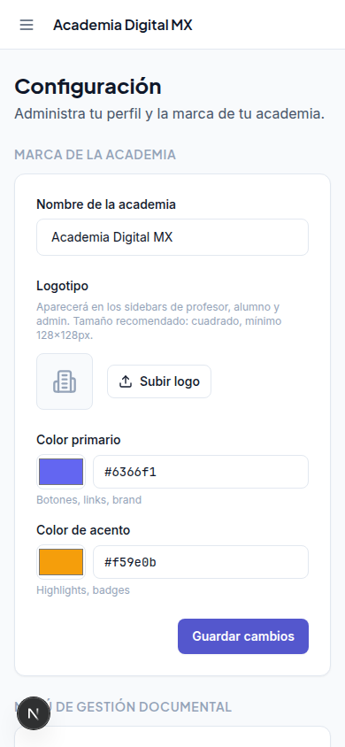
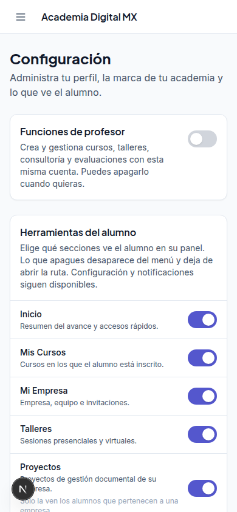
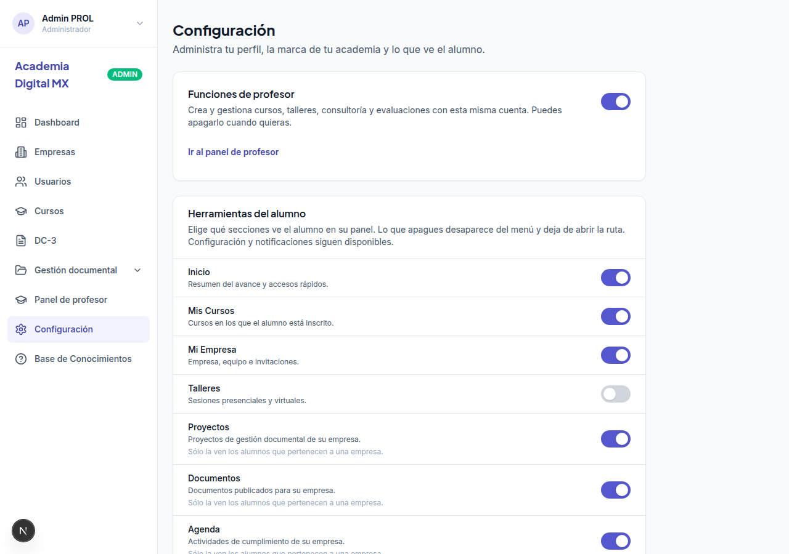
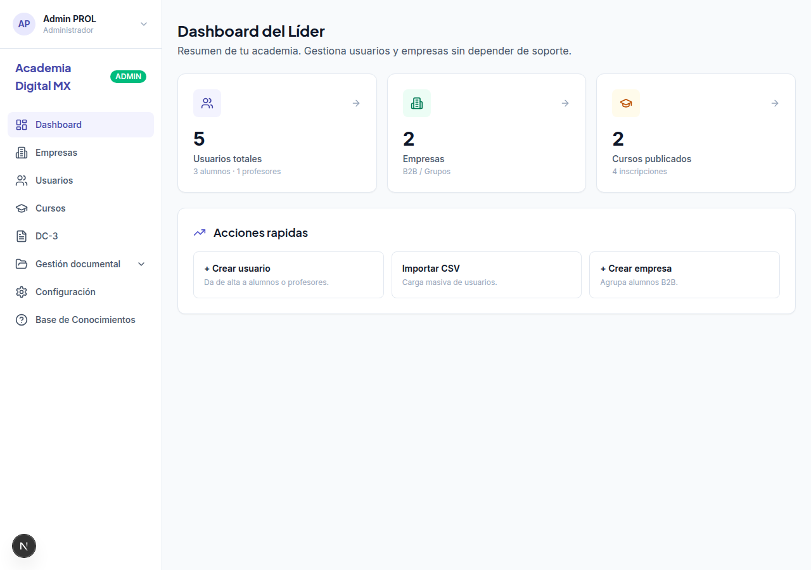
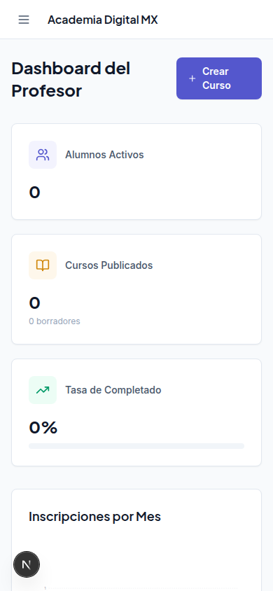
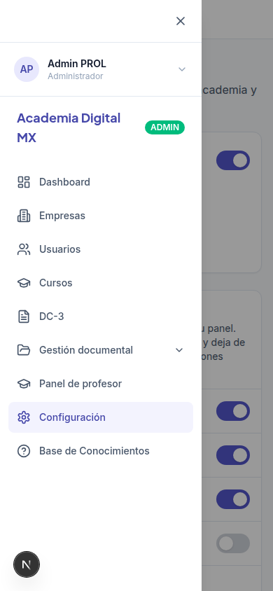
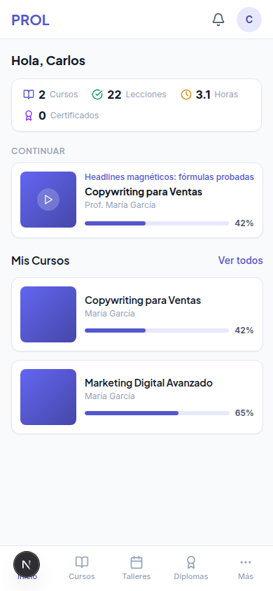
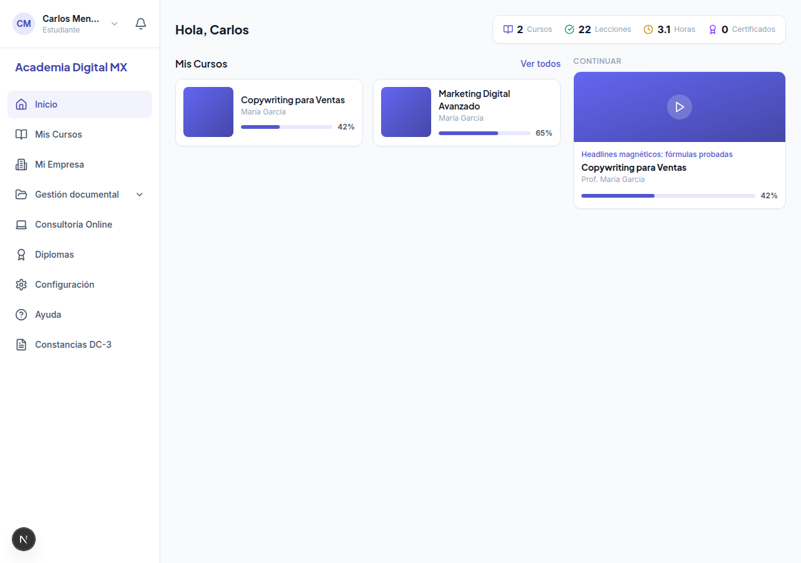
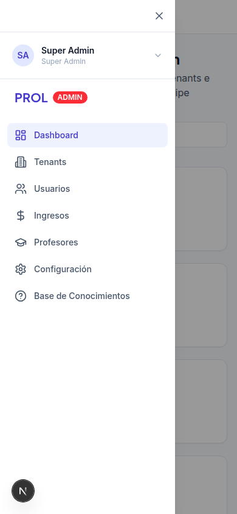

# Auditoría UX mobile-first: paneles de admin, profesor y alumno

Revisión hecha sobre la academia de demostración, a 390px de ancho (y algunas vistas de escritorio a 1280px). El producto se usa con una mano y clases cortas, así que el criterio fue: llegar a la acción con el pulgar, leer sin hacer zoom y no perderse si una sección está vacía o apagada.

Hay dos paneles de administración distintos. El de la academia vive en `/tenant-admin` (rol ADMIN). El de la plataforma vive en `/admin` (rol SUPER_ADMIN). Las funciones nuevas están en el de la academia.

## Qué se veía antes y qué se ve ahora

Ajustes de la academia, 390px. Antes no había forma de dar clases ni de ocultar una sección del alumno.

Los mismos ajustes en escritorio, con el interruptor ya encendido.

El administrador abría `/professor` y volvía a su propio panel. Con el modo encendido entra al panel de profesor y el menú le deja volver.

Lista de cursos del profesor. Antes los botones de cada curso eran iconos pequeños y se salían del ancho del teléfono. Ahora tienen texto y se parten en varias filas.

Barra del alumno. Con Talleres apagado desaparece de la barra. Pedir `/dashboard/workshops` a mano devuelve al inicio: la captura de la ruta bloqueada es el inicio, no la página de talleres.

El panel de la plataforma, para tener el tercer perfil en la misma pasada.

## Hallazgos altos

Estos tocan las pantallas nuevas o eran de bajo riesgo. Quedaron aplicados en este cambio.

1. **Zonas táctiles del menú por debajo de 44px.** El botón de abrir y cerrar el cajón medía unos 36px, y las filas del menú lateral quedaban justas. Ahora el botón del cajón, el cierre, las filas del menú y el avatar del alumno miden al menos 44px. Los interruptores nuevos usan la fila entera, así que el pulgar no tiene que acertar el punto del switch.
2. **Acciones de un curso ilegibles en el teléfono.** En la lista del profesor, Editar, Resultados, Vista previa y Archivar eran pastillas de unos 32px y en 390px se veían como iconos cortados. Ahora miden 44px, llevan texto y bajan a la línea siguiente. El botón Nuevo curso también cabe en su propia fila.
3. **El nombre de la academia se salía de la barra superior.** El título del cajón móvil no se recortaba. Ahora se trunca.
4. **«Workshop» en un panel en español.** El menú del profesor decía Workshop y el del alumno, Talleres. Quien entra desde el modo profesor veía las dos palabras para la misma cosa. El menú del profesor dice Talleres.
5. **El texto auxiliar no se leía.** `--color-text-tertiary` era `#94a3b8`, por debajo de 4.5:1 sobre blanco. Las pistas de las herramientas del alumno usan ese color. Pasó a `#64748b`. El texto secundario (`#475569`) ya cumplía.
6. **Foco del interruptor.** Los switches nuevos tienen anillo al navegar con teclado.

## Hallazgos altos que quedan como recomendación

No los apliqué: cambian la estructura de una pantalla entera, no sólo el detalle.

1. **La lista de cursos del admin de academia sigue siendo una tabla ancha.** En `/tenant-admin/courses`, a 390px hay que desplazar de lado para ver precio, alumnos e ingresos. En el teléfono conviene una tarjeta por curso (título, estado, alumnos) y dejar la tabla para escritorio. Si el admin tiene el modo profesor y el curso es suyo, ya aparece el enlace Editar contenido.
2. **El admin y el super admin no tienen barra inferior.** El alumno sí: cuatro destinos y Más. El admin abre un cajón largo desde arriba a la izquierda, que es el lado difícil para el pulgar derecho. Pasar esos dos paneles al mismo patrón (Inicio, Empresas, Cursos, Más) es un cambio de navegación de todo el producto. Hace falta que Félix lo decida antes de hacerlo.
3. **El cajón duplica la identidad.** Arriba del todo está la tarjeta de la persona y, debajo, otra vez la marca de la academia. En un teléfono se comen la primera pantalla del menú. Recomendación: marca arriba, persona en la fila de la barra, como ya hace el alumno.

## Hallazgos medios

1. **Ajustes es una página larga.** Marca, Stripe, Meet, perfil y sesión siguen debajo. Los dos controles nuevos están los primeros para no tener que bajar a buscarlos. Aun así, en el teléfono la página pide bastante scroll. Se podría partir en «Academia», «Alumnos» y «Cuenta».
2. **La misma sección no se llama igual en todos los paneles.** El alumno ve «Mis Cursos» en el lateral y «Cursos» en la barra. El profesor ve «Cursos» y «Gestión de Cursos». Unificar el nombre corto en el móvil («Cursos») y dejar el largo sólo en el título de la página.
3. **El guardado del interruptor casi no se anuncia.** Mientras guarda, el control baja de opacidad. Si la red va lenta no queda claro si pulsó. Un texto «Guardando…» y el error que ya existe bastarían.
4. **El grupo documental del alumno puede quedar vacío de hijos y aun así no explicar por qué.** Si la academia no tiene el módulo, o el alumno no tiene empresa, la sección no sale aunque el interruptor esté encendido. La pantalla de ajustes lo dice en una pista. En el panel del alumno no hay un estado vacío que lo explique, porque la sección directamente no está. Es coherente con cómo funcionaba antes, y conviene no cambiarlo sin avisar.
5. **Estados vacíos desiguales.** Cursos del admin, talleres del alumno y encuestas tienen un vacío con icono y una frase. Varias listas del profesor y del super admin arrancan en seco cuando no hay datos. Conviene el mismo bloque: qué falta y cuál es el siguiente paso.

## Hallazgos bajos

1. El admin dentro del panel de profesor lleva la chapa PRO. El menú de la persona dice «Administrador · Profesor», que es lo que importa. La chapa se puede dejar o cambiar a ADM.
2. El cajón aparece de golpe, sin transición. No estorba, y una animación corta lo haría más claro.
3. En el inicio del admin, el bloque «Acción requerida» y las tarjetas de acceso compiten al mismo nivel. En el teléfono, lo urgente debería ir solo arriba y el resto debajo.

## Qué no cambié a propósito

Configuración y notificaciones del alumno no tienen interruptor. Apagarlas dejaría a la persona sin salida para su cuenta o sus avisos. El resto de secciones del panel sí se puede apagar, y el valor de partida es el de hoy: visibles, salvo las que ya dependían de un módulo o de pertenecer a una empresa.
